<p align="center">
  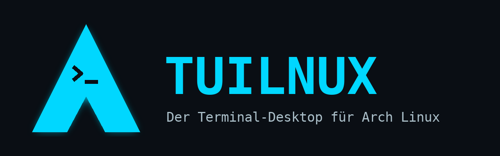
</p>

<p align="center">
  <b>Dein System. Dein eigener Flow.</b><br>
  Eine Desktop-Umgebung für Linux (Arch, Debian, Ubuntu, Fedora, openSUSE …), die aus einem einzigen Vollbild-Terminal besteht.
</p>

<p align="center">
  
  
  
  
  
  
</p>

<p align="center">
  <a href="#features">Features</a> ·
  <a href="#screenshots">Screenshots</a> ·
  <a href="#installation">Installation</a> ·
  <a href="docs/ANLEITUNG.md"><b>Große Anleitung</b></a> ·
  <a href="#entwicklung">Entwicklung</a>
</p>

---

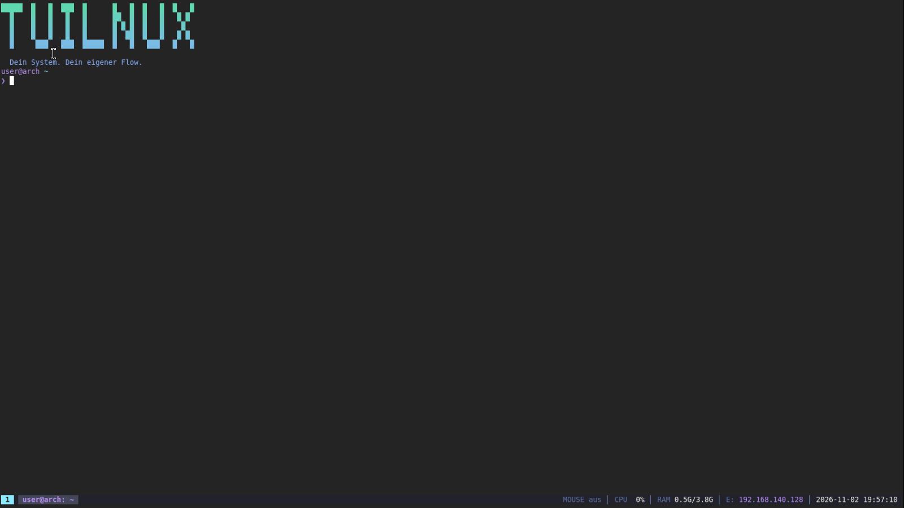

Nach dem Login gibt es kein Startmenü, keine Icons – nur deine Shell im Vollbild und eine
Statusleiste. **Das Terminal ist der Taskmanager**: Programme öffnen sich als Fenster darüber,
minimierte Fenster holst du mit `tab firefox` oder `Strg+Alt+1` zurück, grafische Programme
laufen als echte Wayland-Fenster, und ihre Shell blockiert nie.

## Features

**Desktop**
- 🖥️ Vollbild-Terminal als Desktop mit Statusleiste (Tasks, Maus, CPU, RAM, Netz, Akku, Uhr)
- 🪟 TUI-Fenster über dem Terminal: ziehen, Größe ändern, minimieren, maximieren – per Maus oder Tastatur
- 🔁 `tab NAME`, `Strg+Alt+1…9` und Taskmanager holen minimierte Fenster zurück
- 🦊 GUI-Programme (Firefox, Discord, X11 über Xwayland) als echte Fenster unter **Wayland/labwc**, in Taskleiste und `tab`
- ⏯️ GUI-Programme starten im Hintergrund – `tab --shell firefox` zeigt ihre Ausgabe
- 🖥️🖥️ **Multimonitor**: Anordnung, Desktop-Monitor, Fenster zwischen Monitoren verschieben

**Neu in 0.2.3**
- 🔎 **Programmsuche mit `Super+F`**: installierte Programme (.desktop, Flatpak, TUILNUX-Apps, Befehle) suchen und starten – häufig benutzte zuerst

**Neu in 0.2.2**
- 🚀 **Direkt booten ohne greetd**: `tuilnux-boot autologin` startet TUILNUX sofort als Login-Shell, `console` nach dem Text-Login – umschaltbar im Installer und in tsettings

**Neu in 0.2.1**
- 🐧 **Andere Distributionen**: Debian, Ubuntu, Fedora, openSUSE – `.deb`/`.rpm`-Pakete, apt/rpm-Paketquellen, `install.sh` erkennt apt, dnf und zypper
- 📦 Statische Programme (musl) – laufen auf jeder x86_64-Distribution, auch ohne Rust
- ✏️ Der Bildbetrachter heißt jetzt `tview` (vorher `view`, kollidierte mit vim)

**Neu in 0.2.0**
- 🧙 **Grafischer Installer** (`tuilnux-setup`) mit Logo: Sprache, Tastatur, Bildschirm, Komponenten, Fortschrittsbalken
- 🖼️ **Bilder im Terminal** – Endung egal (PNG, JPEG, GIF, WebP, BMP, TIFF … am Inhalt erkannt); `bild` oder `Alt+V` fügt ein kopiertes Bild ein
- 🌍 **Sprachpakete**: Deutsch, English, Français, Español – live umschaltbar, eigene Pakete als TOML
- 📺 **Auflösung und Hz automatisch**: native Auflösung mit der höchsten Bildrate (z. B. 165 Hz statt 60 Hz), manuell pro Monitor änderbar

**Anmeldung**
- 🔐 `tlogin` (greetd): Pause nach Fehlversuchen, Kontosperre (pam_faillock), Speicher-Hygiene
- 🔑 **Sicherheitsschlüssel** (YubiKey, Nitrokey – FIDO2/U2F) zusätzlich oder statt Passwort
- 📱 **Anmeldung per QR-Code**: Handy mit Authenticator-App koppeln (TOTP)

**Einstellungen**
- ⚙️ `tsettings` mit 18 Bereichen: Farbschemata, Statusleiste, Fenster, Tastatur, Maus, Bildschirme, Grafik & NVIDIA, Wayland, Sprache, Anmeldung, Konto …
- 🐚 Die komplette `.bashrc` und das PS1 einstellbar – mit Live-Vorschau
- 🟩 **NVIDIA**-Unterstützung unter Wayland (Treiber, Modesetting, GBM, VA-API)

**Apps**: `tfiles` (Dateien), `tedit` (Editor), `ttop` (Systemmonitor), `tview`/`bild` (Bilder),
`wallpaper`, `asciia` (Terminal-Animationen), `tterm`.

## Screenshots

| Anmeldung | Desktop mit Fenster |
|---|---|
| 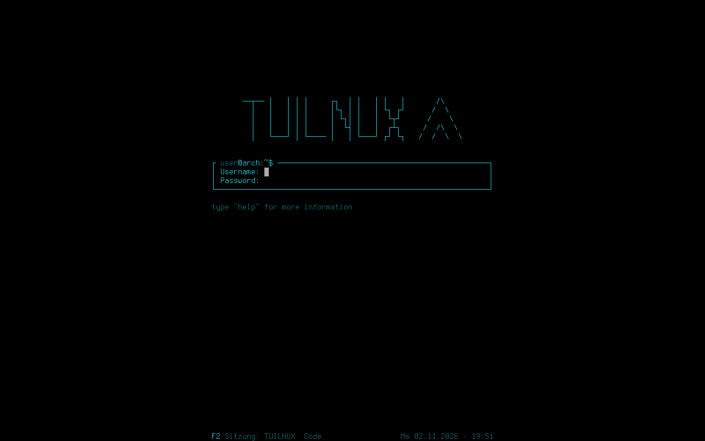 | 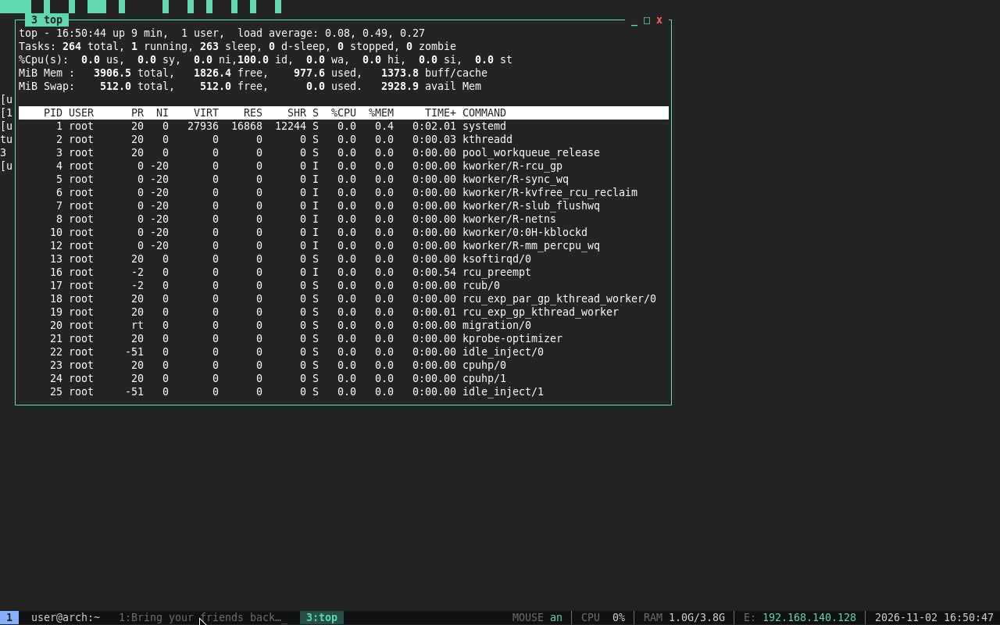 |
| **Installer** | **Installer: Bildschirm & Hz** |
| 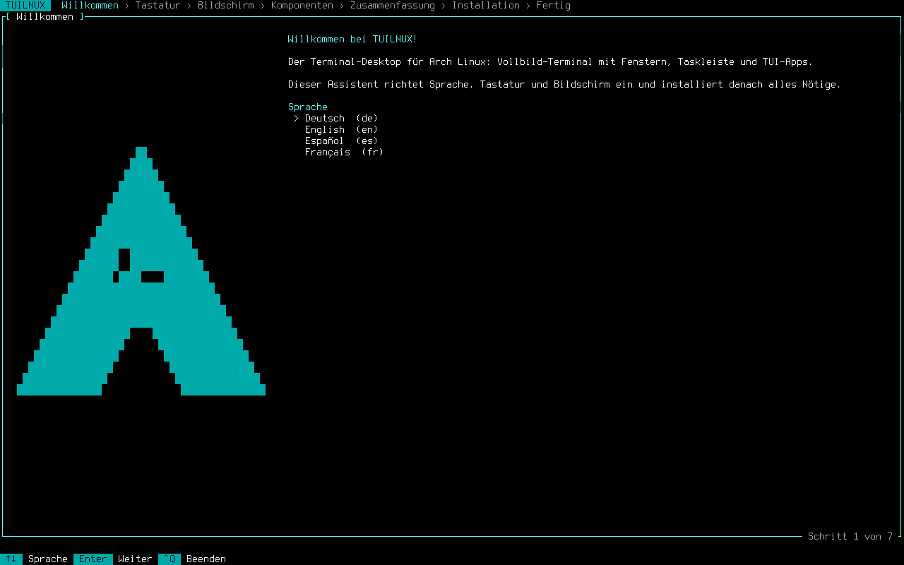 | 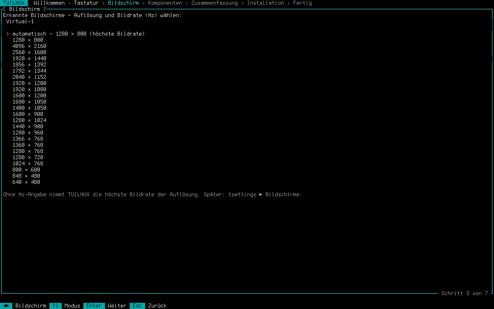 |
| **Installation läuft** | **Bild einfügen (`Alt+V`)** |
| 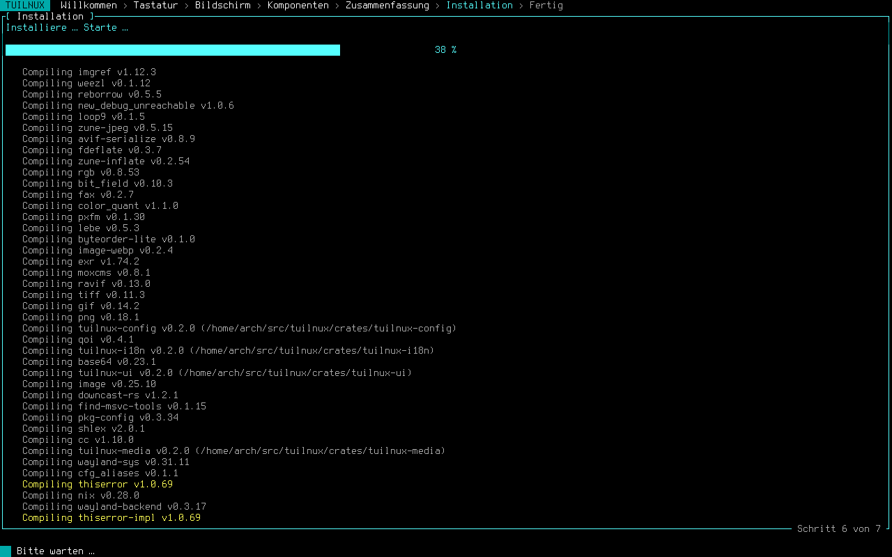 | 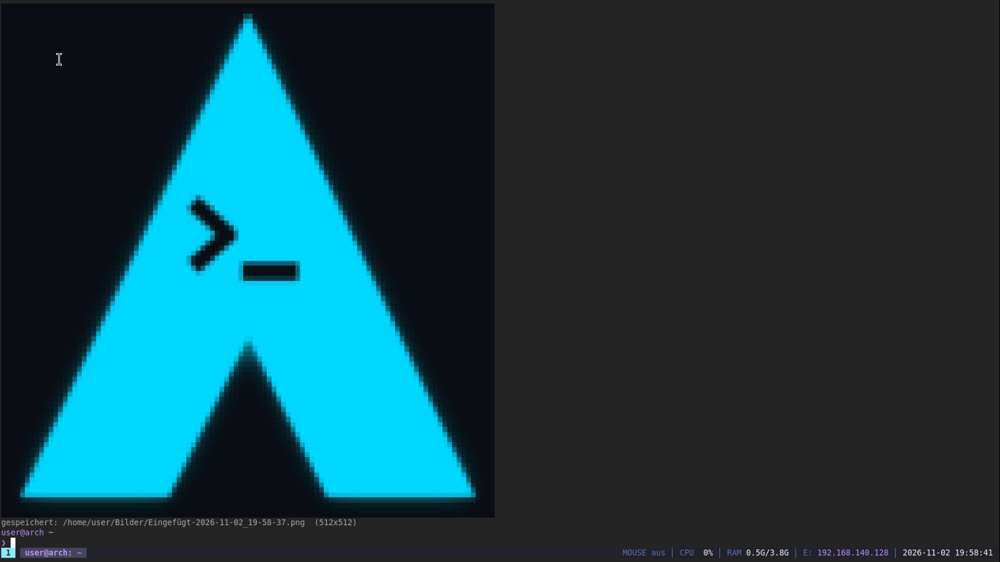 |
| **Einstellungen** | **Shell & Prompt** |
| 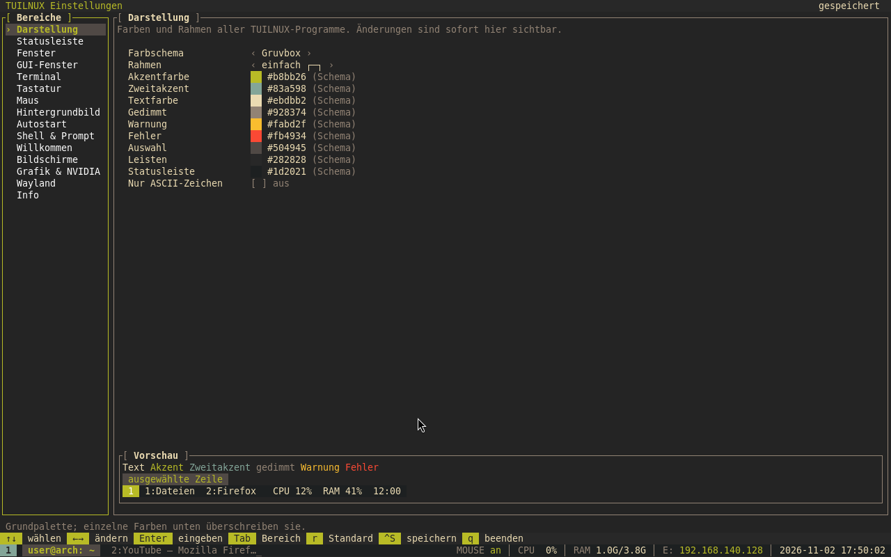 | 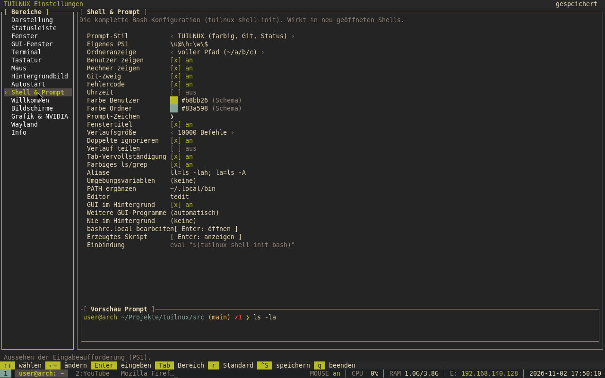 |
| **Bildschirme** | **Sprache: English** |
| 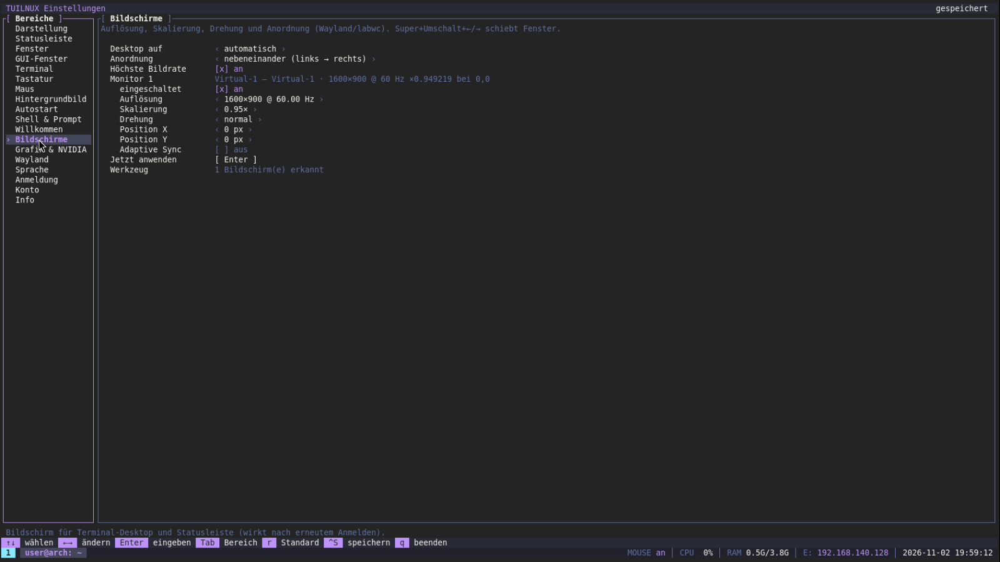 | 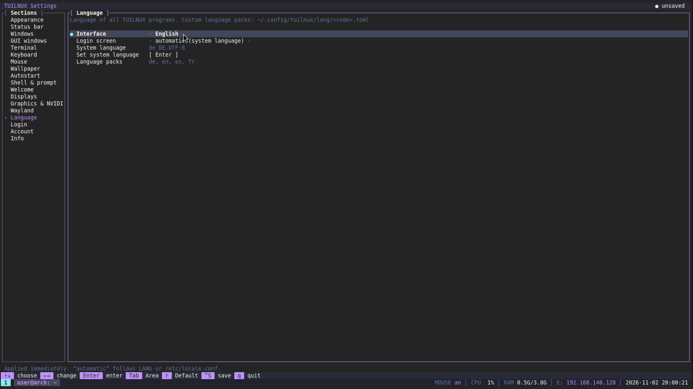 |
| **Programmsuche (`Super+F`)** | |
| 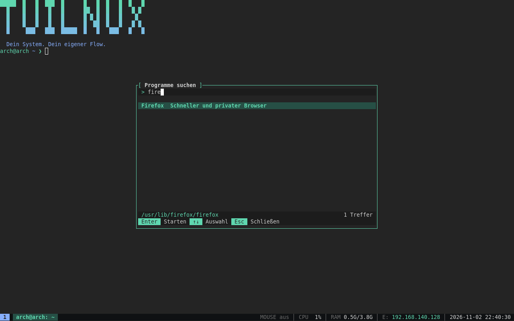 | |
| **Firefox als Fenster** | **Systemmonitor** |
| 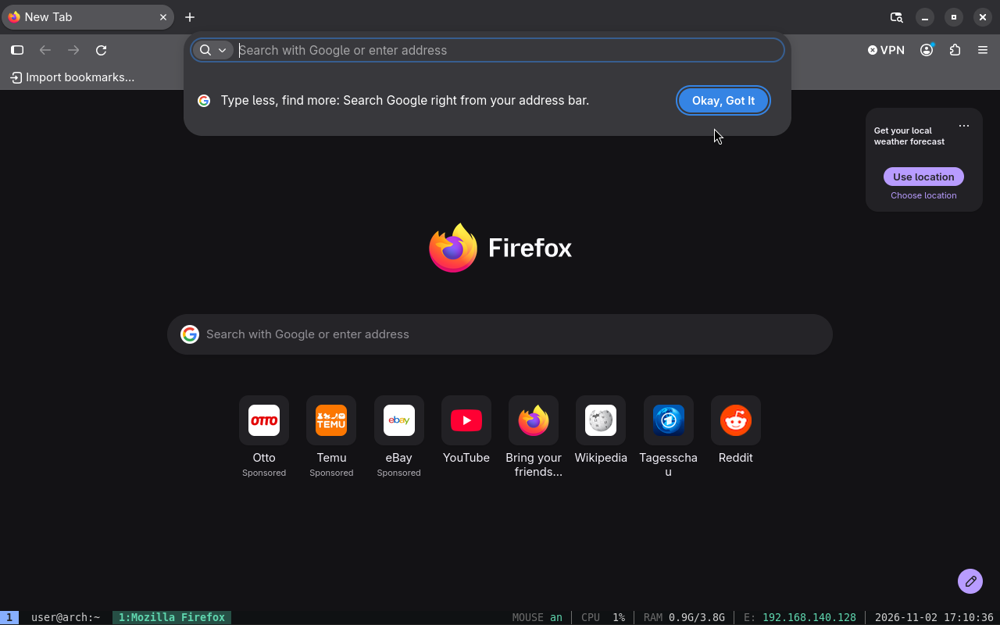 | 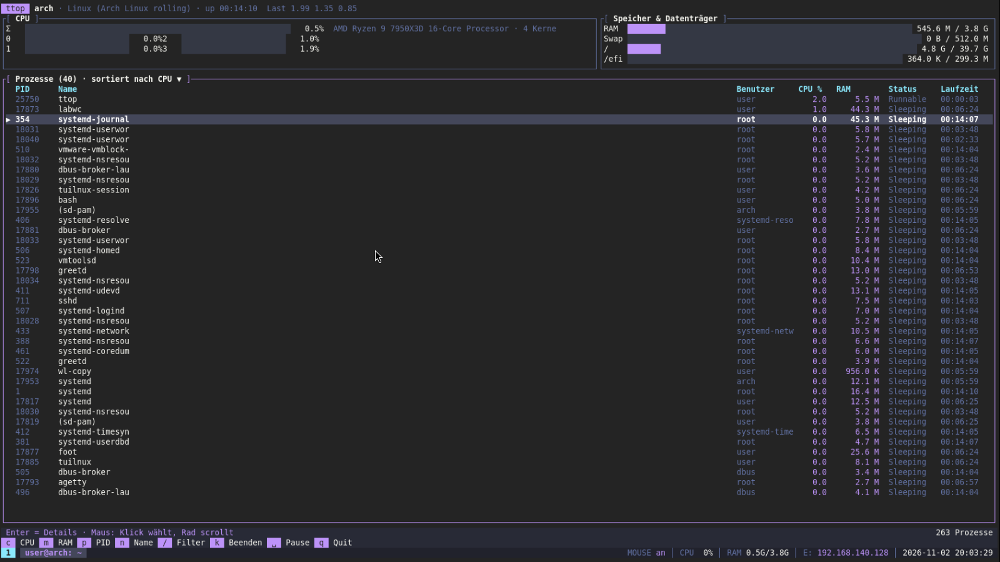 |

## Installation

| Distribution | Weg |
|---|---|
| **Arch Linux**, EndeavourOS, Manjaro | `bash install.sh` oder pacman-Repository / AUR-PKGBUILD |
| **Debian 13**, **Ubuntu 24.04+**, Mint | apt-Paketquelle oder `.deb` |
| **Fedora 41+** | dnf-Paketquelle oder `.rpm` |
| **openSUSE** Tumbleweed | zypper-Paketquelle oder `.rpm` |
| andere (x86_64) | `bash install.sh --prebuilt` oder Tarball aus den Releases |

### Arch Linux

Auf einem frischen **Arch Linux** als normaler Benutzer mit sudo-Rechten:

```sh
sudo pacman -S --needed git
git clone https://github.com/DNSx64/TUILNUX.git
cd TUILNUX
bash install.sh
```

Der **Installations-Assistent** startet automatisch, fragt Sprache, Tastatur, Bildschirm und
Komponenten ab und installiert alles (greetd + tlogin, labwc, foot, Xwayland, Terminus-Schrift,
pacman-Paket `tuilnux`). Danach neu starten – fertig.

```sh
bash install.sh --text                       # ohne Assistent
bash install.sh --yes --lang de_DE.UTF-8 --keymap de-latin1   # vollautomatisch
bash install.sh --dry-run                    # nur anzeigen
bash install.sh --uninstall                  # alles rückgängig
```

Über das **pacman-Repository** (Updates kommen mit `pacman -Syu`):

```sh
printf '\n[tuilnux]\nSigLevel = Optional TrustAll\nServer = https://github.com/DNSx64/TUILNUX/releases/download/repo\n' | sudo tee -a /etc/pacman.conf
sudo pacman -Sy tuilnux
tuilnux-setup        # Sprache, Tastatur, Bildschirm einrichten
```

Als AUR-Paket selbst bauen (der Upload ins AUR folgt, sobald die AUR-Registrierung wieder offen ist):

```sh
git clone https://github.com/DNSx64/TUILNUX.git
cd TUILNUX/dist/aur/tuilnux && makepkg -si     # oder ../tuilnux-git für den main-Stand
```

### Debian / Ubuntu / Mint

```sh
echo 'deb [trusted=yes] https://dnsx64.github.io/TUILNUX/apt ./' | sudo tee /etc/apt/sources.list.d/tuilnux.list
sudo apt update && sudo apt install tuilnux
tuilnux-setup        # Sprache, Tastatur, Bildschirm einrichten
```

labwc, foot, greetd, Xwayland und wlr-randr kommen als empfohlene Pakete automatisch mit.

### Fedora

```sh
sudo curl -fsSLo /etc/yum.repos.d/tuilnux.repo https://dnsx64.github.io/TUILNUX/rpm/tuilnux.repo
sudo dnf install tuilnux
tuilnux-setup
```

### openSUSE

```sh
sudo zypper ar -G -f https://dnsx64.github.io/TUILNUX/rpm tuilnux
sudo zypper in tuilnux labwc foot greetd wlr-randr xwayland
tuilnux-setup
```

### Mit dem Installationsskript (alle Distributionen)

`install.sh` erkennt pacman, apt, dnf und zypper, installiert die Abhängigkeiten, richtet
greetd + tlogin, Schrift und `.bashrc` ein und kann alles wieder entfernen. Außerhalb von Arch
nimmt es die fertigen statischen Programme aus den Releases (nach `/usr/local`) – oder baut
mit `--source` selbst, wenn Rust ≥ 1.85 vorhanden ist.

```sh
git clone https://github.com/DNSx64/TUILNUX.git && cd TUILNUX
bash install.sh              # Assistent; --text ohne Assistent
bash install.sh --prebuilt   # immer fertige Programme
bash install.sh --source     # immer selbst bauen (cargo)
bash install.sh --autologin  # ohne greetd direkt in TUILNUX booten
```

### Direkt booten – ohne greetd

TUILNUX kann auch ohne Anmeldebildschirm direkt nach dem Booten starten (getty-Autologin +
Login-Shell). Umschalten jederzeit mit `tuilnux-boot`:

```sh
sudo tuilnux-boot autologin   # direkt in TUILNUX, ohne Passwort
sudo tuilnux-boot console     # Text-Login, danach TUILNUX
sudo tuilnux-boot greetd      # zurück zu tlogin
```

Hinweis: Sicherheitsschlüssel und Handy-Code gibt es nur mit tlogin (greetd).
Details: [ANLEITUNG §3.7](docs/ANLEITUNG.md#37-direkt-booten-ohne-greetd).

### Fertige Pakete

In den [Releases](https://github.com/DNSx64/TUILNUX/releases): `tuilnux-0.2.3-1-x86_64.pkg.tar.zst`
(Arch), `tuilnux_0.2.3-1_amd64.deb`, `tuilnux-0.2.3-1.x86_64.rpm` und
`tuilnux-0.2.3-x86_64-linux.tar.gz` (statisch, für jede Distribution: nach `/` entpacken).

```sh
sudo pacman -U tuilnux-0.2.3-1-x86_64.pkg.tar.zst      # Arch
sudo apt install ./tuilnux_0.2.3-1_amd64.deb           # Debian/Ubuntu
sudo dnf install ./tuilnux-0.2.3-1.x86_64.rpm          # Fedora
```

➡️ Alle Optionen, Bedienung, Sprachpakete, Bildschirme, sichere Anmeldung und Fehlerbehebung:
**[docs/ANLEITUNG.md](docs/ANLEITUNG.md)**

## Erste Schritte

| Eingabe | Wirkung |
|---|---|
| `files` · `edit datei` · `top` | Dateibrowser · Editor · Systemmonitor als Fenster |
| `firefox` | startet im Hintergrund als Wayland-Fenster |
| `tab` · `tab firefox` · `Strg+Alt+1…9` | Fenster auflisten · zurückholen |
| `tab --shell firefox` | Ausgabe eines Hintergrund-Programms |
| `bild foto` · `bild` · `Alt+V` | Bild anzeigen · aus der Zwischenablage einfügen |
| `Super+F` · `tuilnux search` | installierte Programme suchen und starten |
| `settings` | Einstellungen |
| `Strg+Leertaste` dann `?` | Manager-Modus und Hilfe |
| `tuilnux outputs` | Monitore, Auflösungen und Hz |

## Techstack

| Bereich | Technik |
|---|---|
| Sprache | Rust (Edition 2024, Workspace mit 9 Crates und 8 Apps) |
| TUI | ratatui + crossterm, eigene Terminal-Emulation (vt100, portable-pty) |
| Grafik | Wayland über labwc (wlroots), foot, Xwayland, Layer-Shell (wayland-client); wlr-randr für Bildschirme |
| Anmeldung | greetd-Greeter, PAM, pam_faillock, pam-u2f, google-authenticator (TOTP) |
| Bilder | image-Crate (Formaterkennung am Inhalt), Kitty-Grafikprotokoll / Halbblöcke, wl-clipboard |
| Sprachen | eigene i18n mit TOML-Paketen |
| Paket | PKGBUILD (pacman), install.sh |

## Entwicklung

```sh
cargo build --release
cargo test --workspace
cargo clippy --workspace --all-targets -- -D warnings
cargo run -p tlogin -- --demo     # Login ohne greetd (Passwort: tuilnux)
cargo run -p tuilnux              # Desktop in jedem Terminal
cargo run -p tuilnux-setup        # Installer-Oberfläche
```

Aufbau des Workspaces: siehe [Anleitung, Kapitel 21](docs/ANLEITUNG.md#21-entwicklung).

## Lizenz

[MIT](LICENSE)