# TUILNUX – Anleitung

Diese Anleitung erklärt Installation, Einrichtung und Bedienung von TUILNUX 0.2.0 Schritt für Schritt.
Die Kurzfassung steht in der [README](../README.md).

**Inhalt**

1. [Was ist TUILNUX?](#1-was-ist-tuilnux)
2. [Voraussetzungen](#2-voraussetzungen)
3. [Installation](#3-installation)
   - [3.1 Grafischer Installer (empfohlen)](#31-grafischer-installer-empfohlen)
   - [3.2 Textmodus / automatisiert](#32-textmodus--automatisiert)
   - [3.3 Fertiges Paket (pacman)](#33-fertiges-paket-pacman)
   - [3.3a AUR (yay/paru)](#33a-aur-yayparu)
   - [3.4 Andere Distributionen](#34-andere-distributionen)
   - [3.5 Was der Installer verändert](#35-was-der-installer-verändert)
   - [3.6 Deinstallieren](#36-deinstallieren)
4. [Erster Start und Anmeldung](#4-erster-start-und-anmeldung)
5. [Der Desktop](#5-der-desktop)
6. [Fenster, Taskleiste und Taskmanager](#6-fenster-taskleiste-und-taskmanager)
7. [Grafische Programme und Hintergrund-Jobs](#7-grafische-programme-und-hintergrund-jobs)
8. [Bilder im Terminal](#8-bilder-im-terminal)
9. [Sprachen und Sprachpakete](#9-sprachen-und-sprachpakete)
10. [Bildschirme: Auflösung, Hz, Multimonitor](#10-bildschirme-auflösung-hz-multimonitor)
11. [Einstellungen (tsettings)](#11-einstellungen-tsettings)
12. [Sichere Anmeldung: Sperre, Sicherheitsschlüssel, QR-Code](#12-sichere-anmeldung-sperre-sicherheitsschlüssel-qr-code)
13. [Shell, Prompt und .bashrc](#13-shell-prompt-und-bashrc)
14. [NVIDIA](#14-nvidia)
15. [Sitzungs-Backends](#15-sitzungs-backends)
16. [Befehlsreferenz](#16-befehlsreferenz)
17. [Tastenkürzel der Apps](#17-tastenkürzel-der-apps)
18. [ASCIIA-Animationen](#18-asciia-animationen)
19. [Dateien und Pfade](#19-dateien-und-pfade)
20. [Fehlerbehebung](#20-fehlerbehebung)
21. [Entwicklung](#21-entwicklung)

---

## 1. Was ist TUILNUX?

TUILNUX ist eine Desktop-Umgebung, die aus einem **Vollbild-Terminal** besteht. Nach dem Login
siehst du nur deine Shell und unten eine Statusleiste. Das Terminal ist gleichzeitig
Taskmanager: Programme öffnen sich als Fenster darüber, minimierte Fenster holst du mit
`tab NAME` zurück, grafische Programme (Firefox, Discord …) laufen als echte Wayland-Fenster.

Bausteine:

| Programm | Aufgabe |
|---|---|
| `tlogin` | Anmeldebildschirm (greetd-Greeter) |
| `tuilnux` | Desktop: Vollbild-Shell, TUI-Fenster, Taskleiste, Taskmanager, Steuer-CLI |
| `tuilnux-session` | Startet das passende Backend (labwc, cage oder Linux-Konsole) |
| `tuilnux-setup` | Grafischer Installer / Ersteinrichtung |
| `tsettings` | Einstellungen |
| `tfiles`, `tedit`, `ttop` | Dateibrowser, Editor, Systemmonitor |
| `view`, `wallpaper`, `asciia` | Bilder anzeigen/einfügen, Hintergrundbild, Animationen |
| `tterm` | Schlankes Einzel-Terminal mit Statusleiste |

## 2. Voraussetzungen

- **Arch Linux** (empfohlen; andere Distributionen siehe [3.4](#34-andere-distributionen)), x86_64 oder aarch64
- Ein Benutzer mit `sudo`-Rechten
- Internetzugang für Pakete und Rust-Abhängigkeiten
- Für das grafische Backend: eine Grafikkarte mit KMS-Treiber (Intel, AMD, NVIDIA mit
  `nvidia_drm.modeset=1`, VMware/VirtualBox/QEMU). Ohne 3D-Beschleunigung rendert labwc in Software.

## 3. Installation

Quellcode holen:

```sh
sudo pacman -S --needed git
git clone https://github.com/DNSx64/TUILNUX.git
cd TUILNUX
```

### 3.1 Grafischer Installer (empfohlen)

```sh
bash install.sh
```

Auf einem Terminal startet beim ersten Aufruf automatisch der **Installations-Assistent**
`tuilnux-setup` (dafür wird zuerst kurz Rust installiert und der Assistent gebaut). Er führt durch
sechs Schritte:

| Schritt | Inhalt |
|---|---|
| Willkommen | Logo, Sprache des Installers und des Systems (Deutsch, English, Français, Español) |
| Tastatur | Belegung für Konsole und Desktop (Deutsch, Schweiz, Österreich, US, Französisch, Spanisch …) |
| Bildschirm | erkannte Monitore mit allen Modi; „automatisch – höchste Bildrate“ wählt Auflösung **und** Hz selbst |
| Komponenten | grafischer Desktop (labwc), Anmeldebildschirm (greetd + tlogin), NVIDIA, Terminus-Schrift, .bashrc, Tests |
| Zusammenfassung | alles noch einmal, zurück mit `Esc` |
| Installation | Fortschrittsbalken mit aktuellem Schritt und Protokoll; am Ende werden die Benutzereinstellungen geschrieben |

| | |
|---|---|
| 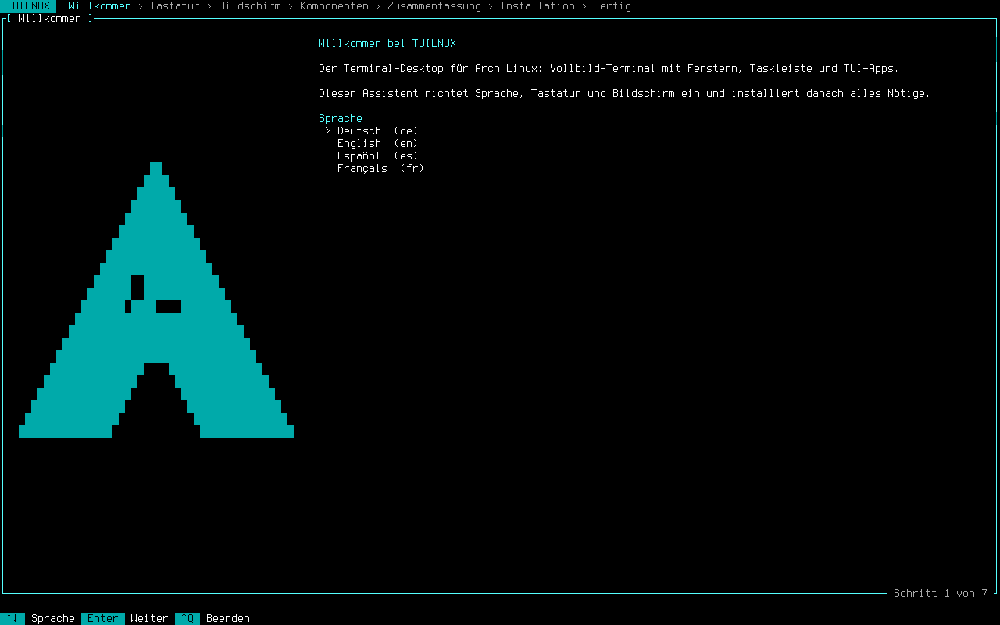 | 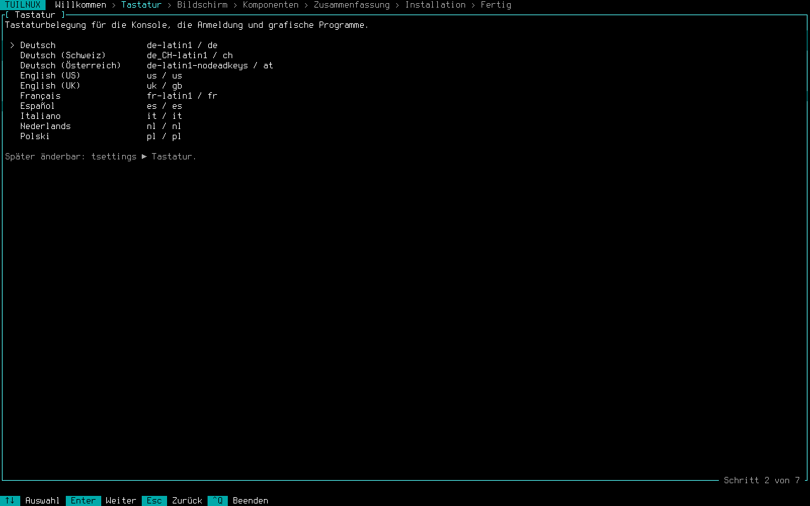 |
| 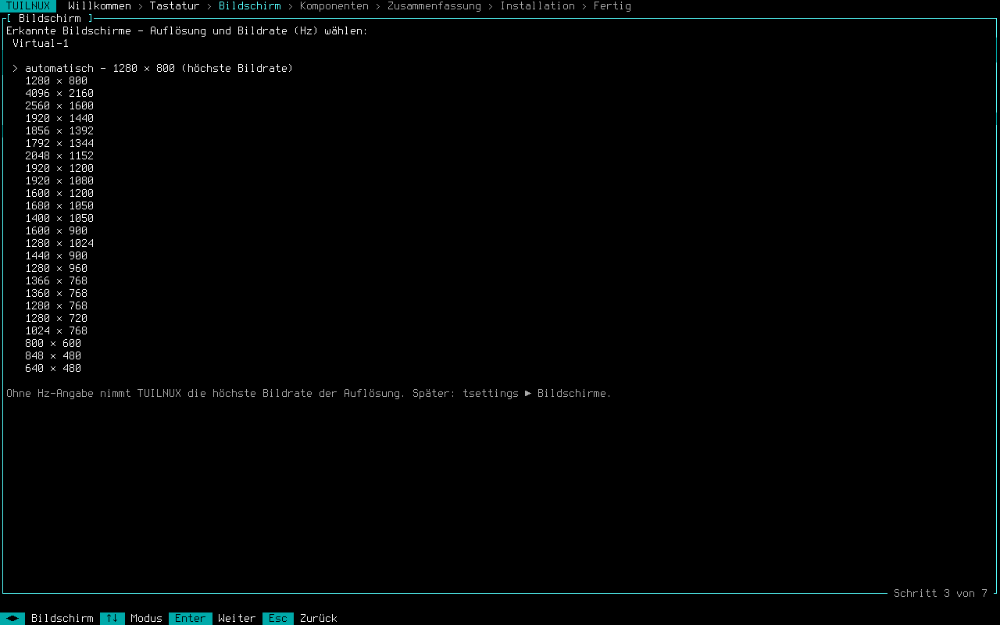 | 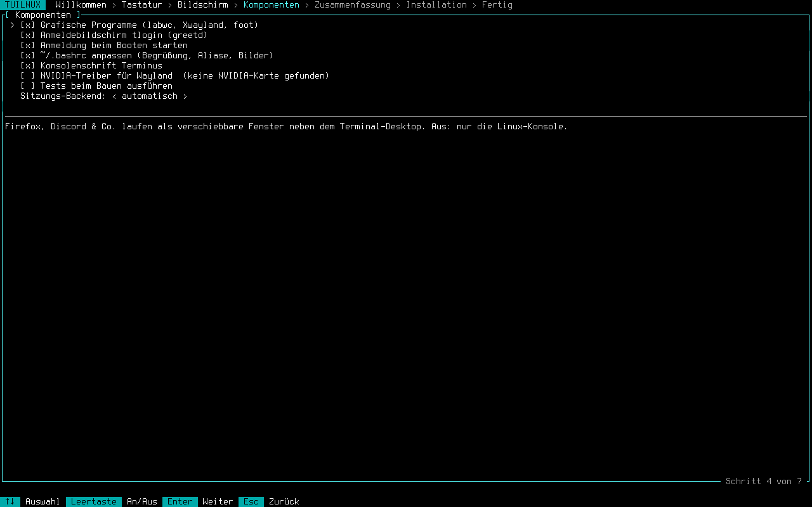 |
| 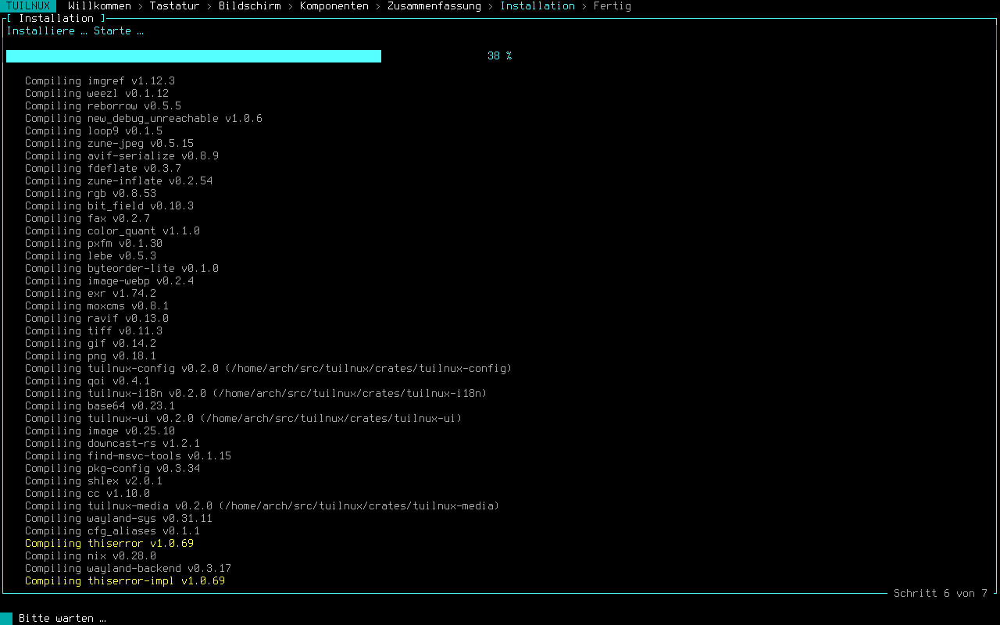 | 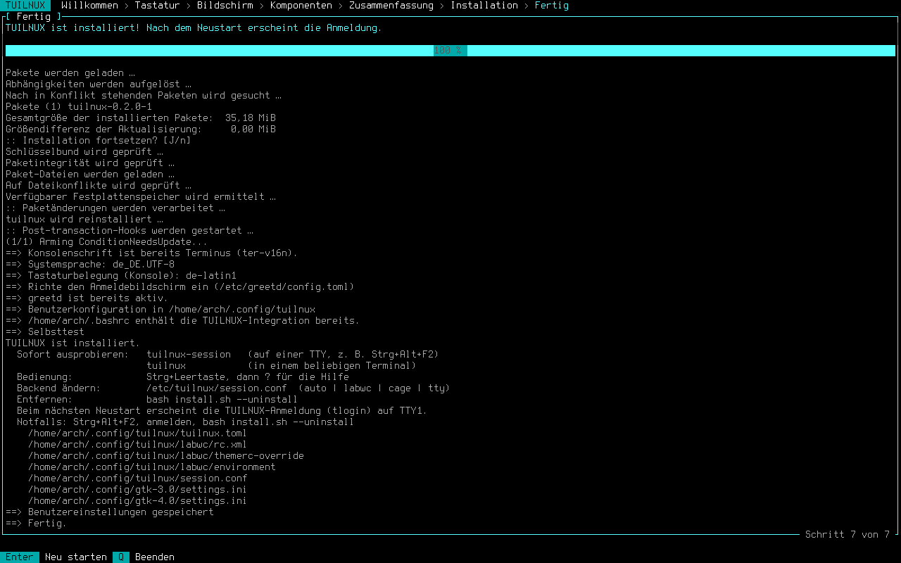 |

Bedienung: `↑↓` wählen, `←→`/`Leertaste` ändern, `Enter` weiter, `Esc` zurück, `q` abbrechen.
Die Sprache wechselt sofort, sobald du sie auf der ersten Seite änderst
([Beispiel auf Englisch](screenshots/setup-english.png)). Auf der reinen Linux-Konsole wird das
Logo in zwei Farben gezeichnet, in grafischen Terminals als PNG-Logo in Halbblöcken.

Danach neu starten – es erscheint der TUILNUX-Login.

Der Assistent lässt sich auch später starten:

```sh
tuilnux-setup                 # nur Sprache, Tastatur und Bildschirm des installierten Systems
tuilnux-setup --root ~/TUILNUX  # mit Quellordner: komplette (Neu-)Installation
bash install.sh --tui         # Assistent erzwingen
```

### 3.2 Textmodus / automatisiert

```sh
bash install.sh --text                      # klassisch, mit Rückfragen
bash install.sh --yes                       # keine Rückfragen (für Skripte)
bash install.sh --yes --lang de_DE.UTF-8 --keymap de-latin1
bash install.sh --dry-run                   # nur anzeigen, was passieren würde
```

| Option | Wirkung |
|---|---|
| `--yes`, `-y` | keine Rückfragen |
| `--tui` / `--text` | Assistent erzwingen / ohne Assistent installieren |
| `--lang LOCALE` | Systemsprache setzen, z. B. `de_DE.UTF-8` (locale-gen + localectl) |
| `--keymap KEYMAP` | Konsolen-Tastatur, z. B. `de-latin1` |
| `--backend B` | `auto` (Standard), `labwc`, `cage` oder `tty` |
| `--minimal` | ohne labwc, foot, Xwayland, wlr-randr (nur Linux-Konsole) |
| `--nvidia` / `--no-nvidia` | NVIDIA-Treiber für Wayland einrichten / nicht anfassen |
| `--no-greetd` | keinen Anmeldebildschirm einrichten |
| `--no-enable` | greetd einrichten, aber nicht beim Booten aktivieren |
| `--no-bashrc` | `~/.bashrc` nicht anpassen |
| `--no-font` | Konsolenschrift nicht auf Terminus umstellen |
| `--no-tests` | Tests beim Bauen überspringen |
| `--manual` | auch auf Arch ohne pacman-Paket nach `/usr/local` installieren |
| `--dry-run` | nur anzeigen |
| `--uninstall` | entfernen und vorherigen Login wiederherstellen |

Umgebungsvariablen: `TUILNUX_CONSOLE_FONT=ter-v32n` (eigene Konsolenschrift), `TUILNUX_ASCII=1|0`
(ASCII- bzw. Unicode-Rahmen erzwingen).

### 3.3 Fertiges Paket (pacman)

Jedes [Release](https://github.com/DNSx64/TUILNUX/releases) enthält ein fertiges Arch-Paket:

```sh
sudo pacman -U tuilnux-0.2.0-1-x86_64.pkg.tar.zst
sudo pacman -S --needed greetd labwc foot xorg-xwayland wlr-randr wl-clipboard terminus-font
```

Das Paket installiert nur die Programme und Dateien. Login (greetd), `.bashrc`, Sprache und
Schrift richtet danach `tuilnux-setup` oder `bash install.sh` aus dem Quellordner ein.
Selbst bauen: `cd dist/arch && makepkg -si`.

Optionale Abhängigkeiten des Pakets: `greetd`, `pam-u2f`, `libpam-google-authenticator`, `labwc`,
`xorg-xwayland`, `foot`, `wlr-randr`, `wl-clipboard`, `nvidia-utils`, `cage`, `gpm`, `terminus-font`.

### 3.3a AUR (yay/paru)

TUILNUX gibt es im Arch User Repository in zwei Varianten:

| Paket | Inhalt |
|---|---|
| [`tuilnux`](https://aur.archlinux.org/packages/tuilnux) | letzte Version (Release-Tag, Prüfsumme) |
| [`tuilnux-git`](https://aur.archlinux.org/packages/tuilnux-git) | aktueller Stand von `main` |

```sh
yay -S tuilnux            # oder paru -S tuilnux
sudo pacman -S --needed greetd labwc foot xorg-xwayland wlr-randr wl-clipboard terminus-font
tuilnux-setup             # Sprache, Tastatur, Bildschirm
```

Ohne AUR-Helfer:

```sh
git clone https://aur.archlinux.org/tuilnux.git
cd tuilnux && makepkg -si
```

Wie beim fertigen Paket richtet danach `tuilnux-setup` das System ein. Anmeldung über greetd:

```sh
sudo cp /usr/share/tuilnux/greetd/config.toml /etc/greetd/config.toml
sudo systemctl enable greetd.service
```

**Für Maintainer** – die AUR-Dateien liegen in [`dist/aur/`](../dist/aur):

1. Einmalig: Konto auf <https://aur.archlinux.org/register>, unter „SSH Public Key“ den Inhalt
   von `~/.ssh/aur.pub` eintragen. In `~/.ssh/config` steht:
   `Host aur.archlinux.org` / `IdentityFile ~/.ssh/aur` / `User aur`.
2. Neue Version: `version` in `Cargo.toml` und `pkgver` in `dist/aur/tuilnux/PKGBUILD` erhöhen,
   `pkgrel=1`, Tag `vX.Y.Z` pushen, in einer Arch-Umgebung `updpkgsums` und
   `makepkg --printsrcinfo > .SRCINFO` ausführen und mit `makepkg -f` und `namcap` testen.
3. Hochladen: `pwsh dist/aur/publish.ps1` (beide Pakete) oder `-Packages tuilnux`;
   `-DryRun` bereitet nur vor.

### 3.4 Andere Distributionen

Ohne pacman baut `install.sh` mit cargo und installiert nach `/usr/local`. Abhängigkeiten selbst
installieren: Rust ≥ 1.85, optional greetd, labwc, foot, Xwayland, wlr-randr, wl-clipboard.

### 3.5 Was der Installer verändert

- Pakete (Arch): `base-devel`, `rust` (falls kein cargo da ist), `greetd`, `labwc`, `xorg-xwayland`,
  `foot`, `ttf-dejavu`, `wlr-randr`, `wl-clipboard`, `terminus-font`.
- Baut aus `dist/arch/PKGBUILD` das Paket `tuilnux` (inklusive Tests) und installiert es.
- `/etc/greetd/config.toml` wird gesichert (`.tuilnux-backup`) und auf `tlogin` umgestellt;
  `greetd` wird aktiviert. Ein laufender Anmeldemanager (sddm, gdm …) wird nur nach Rückfrage
  deaktiviert und beim Deinstallieren wieder aktiviert.
- `~/.bashrc` bekommt einen markierten Block, der `/usr/share/tuilnux/bashrc.sh` lädt.
- Konsolenschrift Terminus in `/etc/vconsole.conf` (`ter-v16n`, ab 2560 px Breite `ter-v32n`),
  optional Systemsprache (`/etc/locale.conf`) und Konsolen-Tastatur (`KEYMAP=`).
- NVIDIA (nur mit Karte und Zustimmung): siehe [Kapitel 14](#14-nvidia).

### 3.6 Deinstallieren

```sh
bash install.sh --uninstall
```

Stellt den vorherigen Login und die Konsolenschrift wieder her und entfernt den `.bashrc`-Block.

## 4. Erster Start und Anmeldung

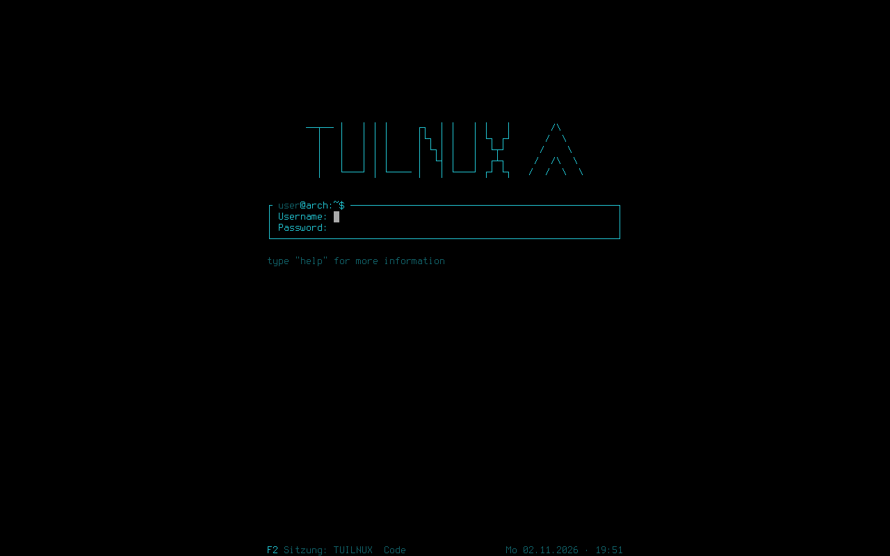

Nach dem Neustart erscheint `tlogin`: das TUILNUX-Logo und darunter die Box `user@arch` mit
**Username** und **Password**.

- `help` im Benutzerfeld zeigt Befehle (`reboot`, `poweroff`).
- `F2` wechselt die Sitzung: `TUILNUX` (Desktop), `Terminal` (`tterm`), `Bash`.
- `Esc` geht zurück zum Benutzernamen.
- Nach mehreren Fehlversuchen kommt eine wachsende Pause, danach sperrt `pam_faillock` das Konto
  (Details in [Kapitel 12](#12-sichere-anmeldung-sperre-sicherheitsschlüssel-qr-code)).

Die Sprache des Anmeldebildschirms folgt der Systemsprache oder wird in tsettings → Anmeldung
festgelegt.

Zweite Konsole für Notfälle: `Strg+Alt+F2`.

## 5. Der Desktop

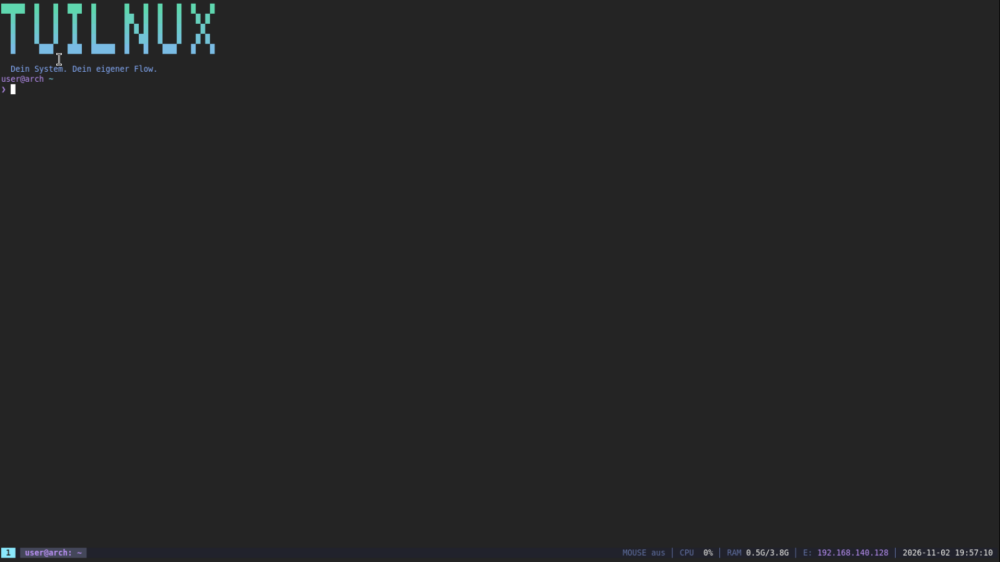

Nach dem Login gibt es nur die Shell im Vollbild und die **Statusleiste**:

`1` (Workspace/Taskmanager) · Tasks · `MOUSE an/aus` · CPU · RAM · Netz (IP) · Akku · Uhrzeit

Die Begrüßung (ASCIIA-Animation „TUILNUX“ und ein Spruch) lässt sich in tsettings → Willkommen
ändern oder abschalten. Das Hintergrundbild aus `wallpaper set bild.png` erscheint hinter dem Text.

## 6. Fenster, Taskleiste und Taskmanager

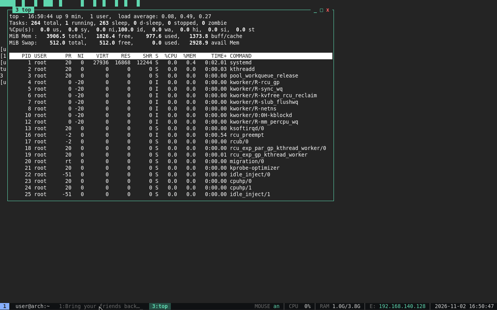

Terminal-Programme öffnest du einfach aus der Shell; sie erscheinen als Fenster über dem Desktop:

```sh
files            # Dateibrowser (tfiles)
edit notiz.txt   # Editor (tedit)
top              # Systemmonitor (ttop)
open datei       # passende App für die Datei
tuilnux open -- htop   # beliebiges Programm als Fenster
```

Mit der Maus (sobald ein Fenster offen ist, steht in der Leiste `MOUSE an`):

- Titelleiste ziehen = verschieben; linken/rechten/unteren Rand oder die unteren Ecken ziehen = Größe
- `_ □ x` in der Titelleiste, Doppelklick auf den Titel = maximieren
- Klick auf einen Task in der Leiste holt ihn nach vorne bzw. minimiert ihn, Klick auf `1` öffnet den Taskmanager

Minimierte Fenster zurückholen:

| Eingabe | Wirkung |
|---|---|
| `tab` | listet alle Fenster (Nummer, Titel, Status) |
| `tab ttop` | holt das Fenster mit diesem Programm/Titel zurück (Anfang genügt, `Tab` ergänzt) |
| `tab 2` | Fenster Nummer 2 |
| `Strg+Alt+1 … 9` | Fenster 1 … 9 wiederherstellen und nach vorne holen |
| `Strg+Alt+0` | zurück zum Desktop-Terminal |

**Manager-Modus**: `Strg+Leertaste`, danach eine Taste:

| Taste | Wirkung |
|---|---|
| `Tab` · `1`–`9` · `0`/`d` | nächstes Fenster · Fenster N · Desktop |
| `Enter`/`n` | neues Terminal-Fenster |
| `t` | Taskmanager (PID, CPU, RAM; `Enter` Fokus, `m` min, `f` max, `x` schließen, `n` neu) |
| `x` · `m` · `f` | schließen · minimieren · maximieren |
| `←↑→↓` · `Shift`+Pfeile | verschieben · Größe ändern (`Esc` beendet) |
| `s` | Einstellungen |
| `?` · `q` | Hilfe · abmelden |
| Präfix zweimal | Präfix-Taste an das Programm senden |

Steuerung aus der Shell (`$TUILNUX_SOCK` und `$TUILNUX_TOKEN` sind in der Sitzung gesetzt):

```sh
tuilnux open -t Notizen -s 100x30 tedit notes.md
tuilnux list                               # Tasks mit PID, CPU, RAM, Status
tuilnux focus 2 | close 2 | min 2 | max 2  # 0 = Desktop
tuilnux notify "Build fertig"              # Meldung in der Statusleiste
tuilnux logout
```

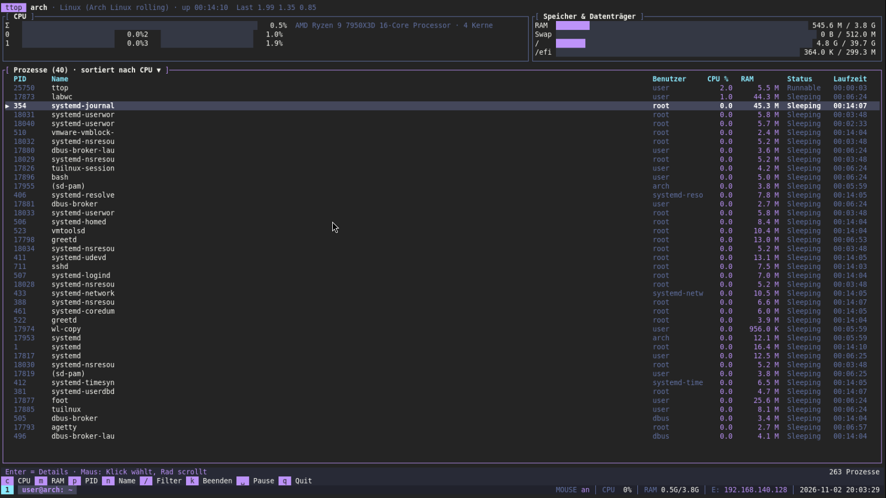

## 7. Grafische Programme und Hintergrund-Jobs

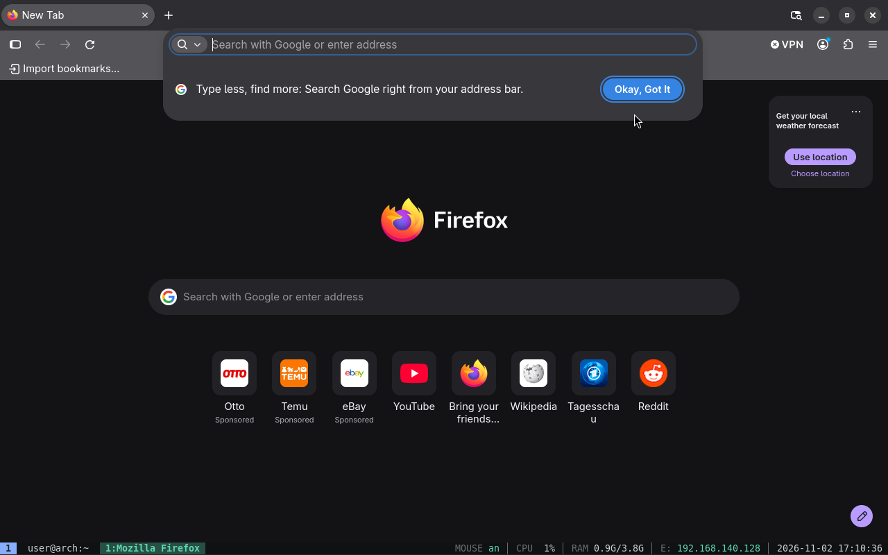

Im `labwc`-Backend öffnen sich grafische Programme als normale Fenster über dem Terminal:
ziehen, Größe ändern, `Alt+Tab` wechselt, `Alt+F4` schließt, `Super+↓` minimiert. Sie haben
`_ □ x` in der Titelleiste (auch Firefox), stehen in der Taskleiste und im Taskmanager, und
`tab firefox` holt sie zurück. Maximiert enden sie über der Statusleiste.

Startest du ein grafisches Programm in der Shell, **blockiert es die Shell nicht**:

```text
❯ firefox
[3] firefox läuft im Hintergrund – Ausgabe: tab --shell firefox
```

| Befehl | Wirkung |
|---|---|
| `tab --shell` | alle Hintergrund-Programme |
| `tab --shell firefox` (`tab -s firefox`) | Shell/Ausgabe des Programms als Fenster; `x` schließt nur das Fenster |
| `launch BEFEHL` | beliebigen Befehl im Hintergrund starten |
| `command firefox` | ausnahmsweise im Vordergrund |

Welche Programme automatisch in den Hintergrund gehen, steht in tsettings → Shell & Prompt.

## 8. Bilder im Terminal

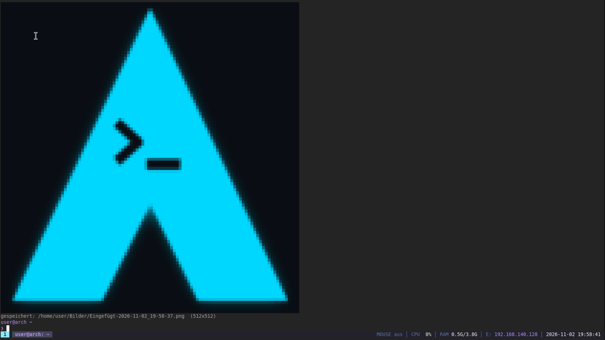

TUILNUX zeigt Bilder direkt im Terminal – in kitty, WezTerm und Ghostty pixelgenau über das
Kitty-Grafikprotokoll, sonst (z. B. in foot und auf der Konsole) in farbigen Halbblöcken. Das Format wird **am Inhalt erkannt, die Dateiendung
ist egal**: PNG, JPEG, GIF, WebP, BMP, TIFF, ICO, QOI, PNM, TGA, … – auch eine Datei `foto`
ohne Endung oder ein falsch benanntes `bild.txt`.

| Eingabe | Wirkung |
|---|---|
| `bild foto` | Datei anzeigen (Kurzform für `view foto`) |
| `bild` | Bild aus der Zwischenablage einfügen, anzeigen und speichern |
| `Alt+V` | dasselbe als Tastenkürzel in der Shell |
| `einfuegen` | Alias für `view --paste` |
| `view --width 60 foto` | mit fester Breite |
| `view --half` / `--kitty` | Darstellung erzwingen |

**Einfügen**: Kopiere ein Bild (z. B. in Firefox „Grafik kopieren“, Screenshot-Werkzeug) oder eine
Bilddatei (im Dateimanager kopieren, Pfad oder `file://`-URI). `bild` bzw. `Alt+V` holt es über
`wl-paste` aus der Zwischenablage, zeigt es an und speichert eingefügte Bilddaten als
`~/Bilder/Eingefügt-JJJJ-MM-TT_hh-mm-ss.png`. Kopierte Dateipfade werden direkt angezeigt.
Voraussetzung: `wl-clipboard` (installiert der Installer) und eine grafische Sitzung (labwc/cage).

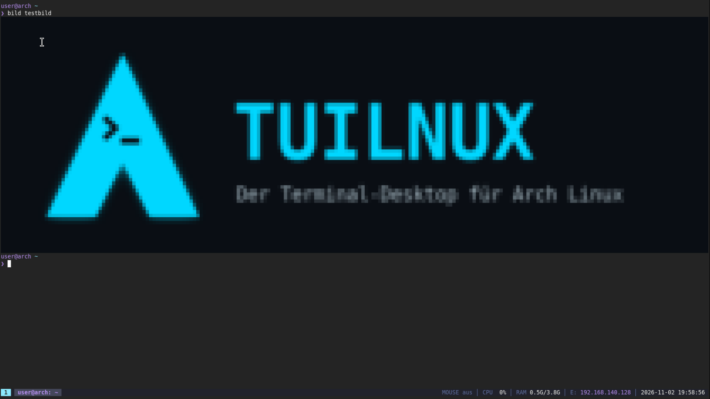

Hintergrundbild: `wallpaper set bild.jpg [--dim 0.55] [--fill|--fit|--center]`, `wallpaper off`.

## 9. Sprachen und Sprachpakete

TUILNUX ist auf Deutsch geschrieben und bringt Sprachpakete mit:

| Code | Sprache | Umfang |
|---|---|---|
| `de` | Deutsch | Original |
| `en` | English | vollständig |
| `fr` | Français | Anmeldung, Installer, Seitentitel, häufige Begriffe; Rest Englisch |
| `es` | Español | wie Französisch |

**Sprache wählen**:

- Im Installer auf der ersten Seite (setzt auch die Systemsprache).
- tsettings → **Sprache**: *Oberfläche* (`automatisch`, Deutsch, English, Français, Español) – wirkt
  sofort; *Anmeldebildschirm* getrennt davon; *Systemsprache setzen* schreibt `/etc/locale.conf`.
- In der Datei: `language = "en"` in `~/.config/tuilnux/tuilnux.toml`.
- Einmalig: `TUILNUX_LANG=fr tsettings`.

`automatisch` nutzt `TUILNUX_LANG`, `LC_ALL`, `LC_MESSAGES`, `LANG` und zuletzt `/etc/locale.conf`.
Unbekannte Sprachen fallen auf Englisch zurück.

| Deutsch | English | Français |
|---|---|---|
| 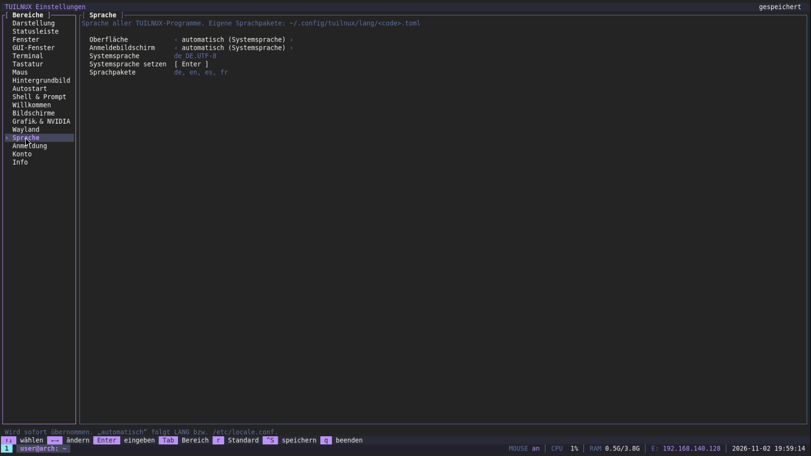 | 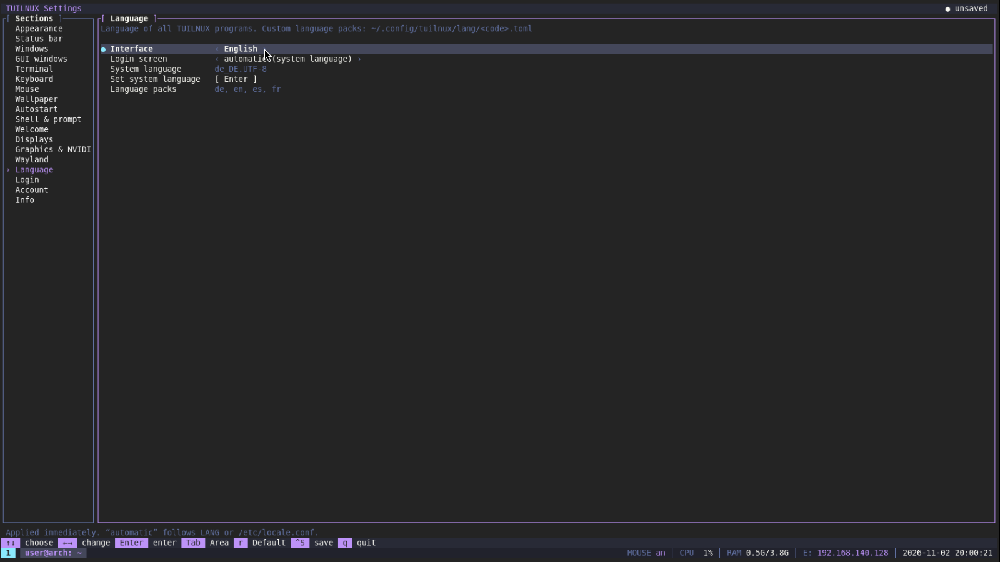 | 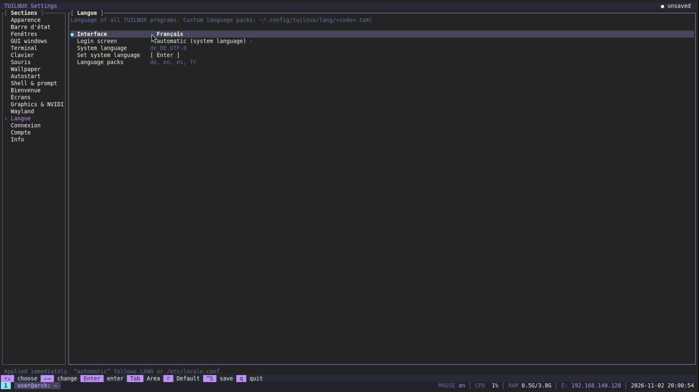 |

**Eigenes Sprachpaket**: eine TOML-Datei mit dem Sprachcode als Namen nach
`~/.config/tuilnux/lang/` (nur für dich), `/etc/tuilnux/lang/` oder `/usr/share/tuilnux/lang/` legen.
Schlüssel ist der deutsche Originaltext, Wert die Übersetzung:

```toml
[meta]
name = "Italiano"

[strings]
"Benutzername" = "Nome utente"
"Einstellungen" = "Impostazioni"
"Darstellung" = "Aspetto"
```

Fehlende Einträge kommen aus dem englischen Paket. Bestehende Pakete lassen sich so auch
ergänzen (gleicher Dateiname, z. B. `fr.toml`). Als Vorlage mit allen Texten dient
[`crates/tuilnux-i18n/lang/en.toml`](../crates/tuilnux-i18n/lang/en.toml).

## 10. Bildschirme: Auflösung, Hz, Multimonitor

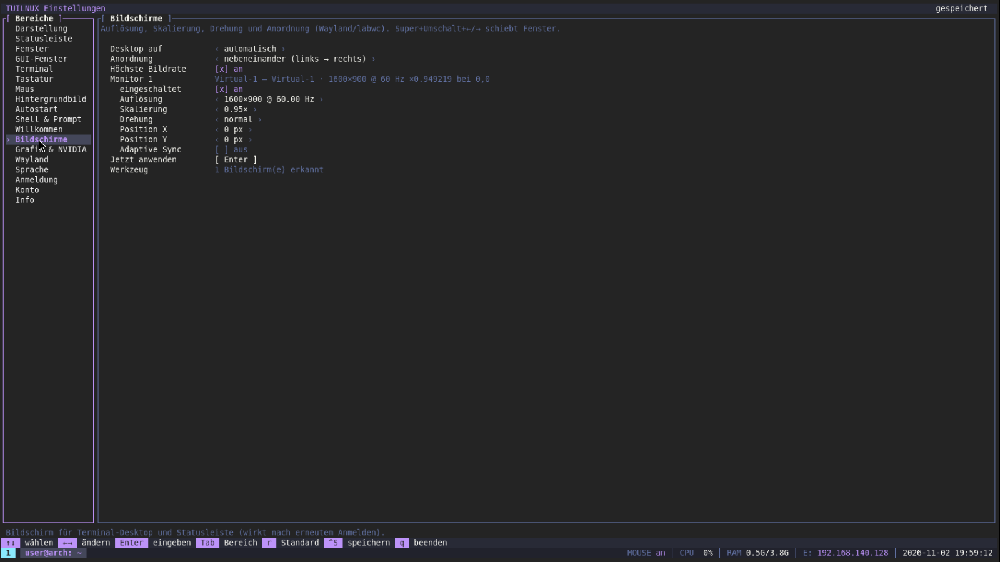

**Automatik**: Ohne feste Einstellung erkennt TUILNUX jeden Monitor selbst und wählt die
empfohlene (native) Auflösung mit der **höchsten Bildwiederholrate**, die der Monitor dafür
anbietet – z. B. 2560×1440 @ 165 Hz statt der oft voreingestellten 60 Hz. Abschaltbar mit
„Höchste Bildrate“ in tsettings → Bildschirme (`max_refresh = false`).

**Manuell** in tsettings → Bildschirme, je Monitor:

- an/aus, **Auflösung & Hz** (Liste aller Modi des Monitors), Skalierung, Drehung, Position,
  Adaptive Sync (FreeSync/G-Sync)
- Desktop-Monitor (dort liegen Terminal und Statusleiste) und Anordnung (rechts, links, unten, manuell)
- „Jetzt anwenden“ testet ohne Speichern, `Strg+S` speichert

Aus der Shell:

```sh
tuilnux outputs            # Monitore, aktueller Modus, alle Modi
tuilnux outputs --apply    # gespeicherte Einstellungen anwenden
```

In der Datei:

```toml
[displays]
desktop = "DP-1"
arrangement = "right"        # right | left | below | manual
max_refresh = true

[[displays.outputs]]
name = "DP-1"
mode = "2560x1440@144"       # leer = automatisch
scale = 1.25

[[displays.outputs]]
name = "HDMI-A-1"
mode = "1920x1080"           # ohne @Hz: höchste Bildrate dieser Auflösung
```

`Super+Umschalt+←/→` schiebt ein GUI-Fenster auf den nächsten Monitor. Neu angesteckte Monitore
bekommen ihre gespeicherten Einstellungen automatisch.

Hinweis: Virtuelle Grafikkarten (VMware, VirtualBox) melden oft keine Bildraten; dann werden die
Modi ohne Hz angezeigt.

## 11. Einstellungen (tsettings)

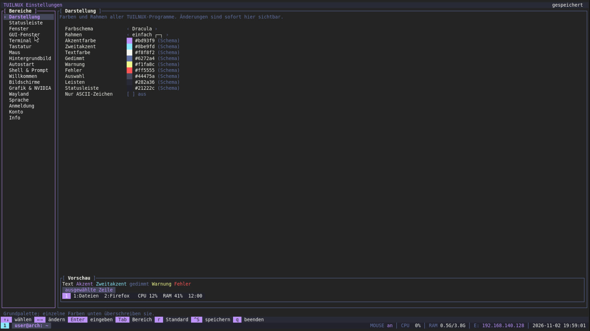

`settings` (oder `tsettings`, Manager-Modus `s`) bearbeitet alles mit Tastatur und Maus.
`↑↓` wählen, `←→`/`Leertaste` ändern, `Enter` Wert eingeben, `Tab` Bereich wechseln,
`r` Standard, `Strg+S` speichern, `q` beenden. Direkt springen: `tsettings maus`.

| Bereich | Einstellungen |
|---|---|
| Darstellung | Farbschema (TUILNUX, Nord, Gruvbox, Dracula, Catppuccin, Solarized, Tokyo Night, Mono), Rahmenart, 9 Einzelfarben, ASCII-Modus, Live-Vorschau |
| Statusleiste | Beschriftung, Module (Maus, CPU, RAM, Netz, Akku, Uhr), Uhrformat, Taskbreite, Meldungsdauer |
| Fenster | Manager-Taste, Größe/Platzierung neuer Fenster, Doppelklick, `Strg+Alt+Zahl`, GUI-Programme in der Taskleiste |
| GUI-Fenster | Titelknöpfe, Titelschrift, Platzierung, Einrasten, Abstand, Eckenradius, Schatten, dunkles GTK, Mauszeiger |
| Terminal | Backend, Terminalprogramm, Schrift, Schriftgröße, Verlauf, Shell |
| Tastatur | XKB-Layout, Variante, Optionen, Wiederholrate, Verzögerung, Num-Lock |
| Maus | Geschwindigkeit, Beschleunigung, natürliches Scrollen, Scrollfaktor, Linkshänder, Tippen, Doppelklickzeit, Fokus folgt Maus |
| Hintergrundbild · Autostart | Bild, Abdunklung, Modus · Programme beim Start |
| Shell & Prompt | komplette Bash-Konfiguration, siehe [Kapitel 13](#13-shell-prompt-und-bashrc) |
| Willkommen | Begrüßung an/aus, auch in Fenstern, eigene `.ASCIIA`-Datei, Zusatztext, Vorschau |
| Bildschirme | siehe [Kapitel 10](#10-bildschirme-auflösung-hz-multimonitor) |
| Grafik & NVIDIA | erkannte GPUs, Modesetting-Status, Renderer (GLES2/Vulkan/Software), Hardware-Mauszeiger, NVIDIA GBM/VA-API, GPU erzwingen, Adaptive Sync, Tearing |
| Wayland | Firefox, Qt, GTK, Electron/Chromium, SDL, Java, Clutter nativ unter Wayland |
| Sprache | siehe [Kapitel 9](#9-sprachen-und-sprachpakete) |
| Anmeldung | Aussehen und Sicherheit des Logins, siehe [Kapitel 12](#12-sichere-anmeldung-sperre-sicherheitsschlüssel-qr-code) |
| Konto | Passwort, Anzeigename, Login-Shell, Gruppen, Sicherheitsschlüssel, Handy (QR) |
| Info | Version, Pfade, Status |

| | |
|---|---|
| 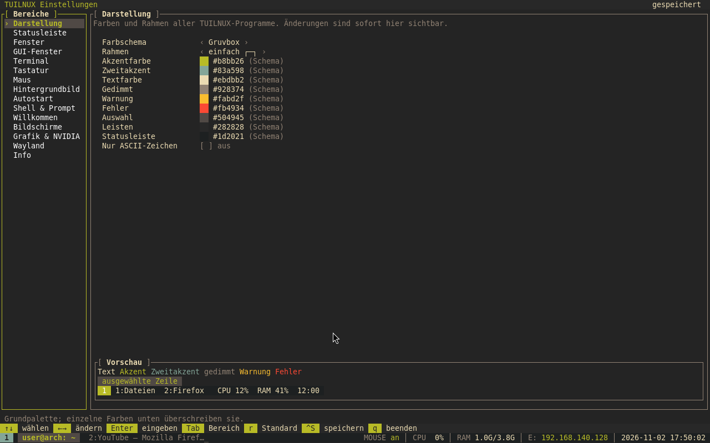 | 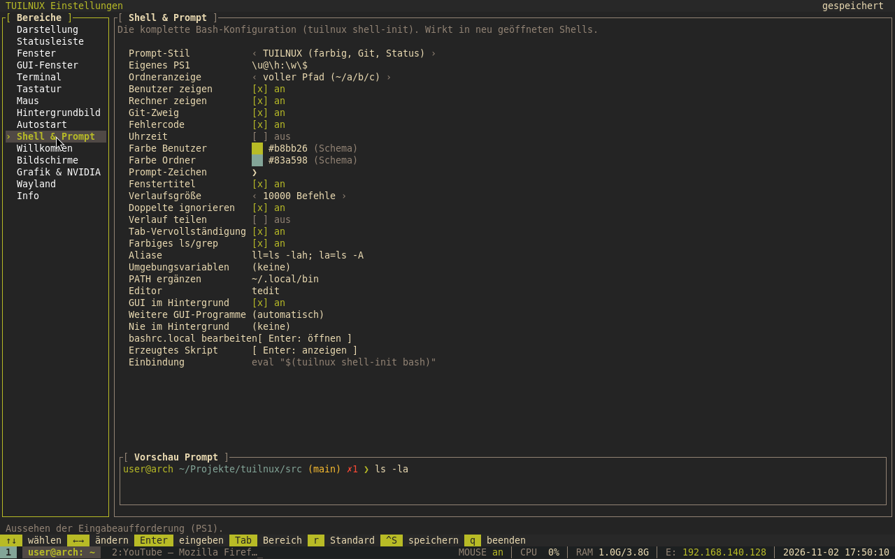 |

Beim Speichern schreibt tsettings `~/.config/tuilnux/tuilnux.toml`, die labwc-Konfiguration
(`~/.config/tuilnux/labwc/`), `session.conf` und die GTK-Einstellungen, lädt labwc und die
laufende Sitzung live neu. Terminal, Schrift und Backend wirken nach erneutem Anmelden.
Die Datei lässt sich auch von Hand bearbeiten (danach `tuilnux reload`).

## 12. Sichere Anmeldung: Sperre, Sicherheitsschlüssel, QR-Code

Einstellbar unter tsettings → **Anmeldung** („Anmeldung testen“ zeigt eine Vorschau,
„Systemweit übernehmen“ ruft `sudo tlogin setup` auf):

- **Schutz**: Pause nach N Fehlversuchen (verdoppelt sich), Kontosperre über `pam_faillock`,
  Eingaben werden nach Inaktivität gelöscht, Passwörter im Speicher überschrieben,
  Passwortlänge verbergen, Feststelltasten-Warnung, Ausschalten/Sitzungswahl abschaltbar, Hinweistext.
- **Sicherheitsschlüssel** (YubiKey, Nitrokey … über `pam-u2f`): `tuilnux key add` (oder tsettings →
  Konto), dann *zusätzlich* zum Passwort berühren oder *statt* Passwort.
- **Anmeldung per QR-Code / Handy**: `tuilnux otp setup` zeigt einen QR-Code im Terminal. Mit
  einer Authenticator-App (Aegis, 2FAS, Google Authenticator …) scannen und Code bestätigen.
  Danach fragt tlogin nach dem 6-stelligen Code (zusätzlich oder statt Passwort).
  Notfall-Codes werden einmal angezeigt.
- Im Modus „zusätzlich“ melden sich Benutzer ohne Schlüssel/Kopplung weiter nur mit Passwort an.
- `tlogin setup` sichert `/etc/pam.d/greetd` und `/etc/security/faillock.conf` als
  `*.tuilnux-orig`, verweigert PAM-Änderungen bei fehlenden Modulen und lässt sich mit
  `sudo tlogin setup --reset` vollständig rückgängig machen.
- Gesperrtes Konto sofort entsperren: `sudo faillock --user NAME --reset`.

## 13. Shell, Prompt und .bashrc

tsettings → **Shell & Prompt** erzeugt die komplette Bash-Konfiguration: Prompt-Stil (TUILNUX,
zweizeilig, klassisch, minimal, eigenes PS1), Ordneranzeige, Benutzer/Rechner/Git-Zweig/
Fehlercode/Uhrzeit, Farben, Prompt-Zeichen, Fenstertitel, Verlauf, Vervollständigung, Aliase,
Umgebungsvariablen, PATH, Editor und GUI-Programme im Hintergrund – mit Live-Vorschau.

Der Installer hängt an `~/.bashrc` einen Block an, der `/usr/share/tuilnux/bashrc.sh` lädt.
Wer seine `.bashrc` selbst pflegt, braucht nur:

```bash
[[ $- == *i* ]] && eval "$(tuilnux shell-init bash)"
```

Eigene Ergänzungen gehören nach `~/.config/tuilnux/bashrc.local`. Das erzeugte Skript ansehen:
`tuilnux shell-init bash`.

## 14. NVIDIA

Steckt eine NVIDIA-Karte im Rechner, fragt der Installer, ob er den Treiber für Wayland einrichten
soll: `nvidia-open-dkms`, `nvidia-utils`, `egl-wayland`, `libva-nvidia-driver`, Kernel-Header,
`/etc/modprobe.d/tuilnux-nvidia.conf` mit `nvidia_drm modeset=1 fbdev=1`, danach `mkinitcpio -P`.
`--nvidia` erzwingt das, `--no-nvidia` lässt es. Feineinstellungen in tsettings → Grafik & NVIDIA.

## 15. Sitzungs-Backends

`tlogin` startet nach der Anmeldung `tuilnux-session`, das laut `/etc/tuilnux/session.conf`
(pro Benutzer: `~/.config/tuilnux/session.conf`) das Backend wählt:

| Backend | Darstellung | Maus | Farben/Schrift |
|---|---|---|---|
| `labwc` | `tuilnux` in `foot` als randloser Vollbild-Desktop unter labwc; GUI-Programme als echte Fenster | voll | 24 Bit, Unicode |
| `cage` | wie labwc, aber Kiosk – GUI-Programme ohne eigene Fenster | voll | 24 Bit, Unicode |
| `tty` | direkt auf der Linux-Konsole | nur Klicks mit `gpm` | 16 Farben |
| `auto` | labwc, sonst cage, sonst tty; ohne 3D-Beschleunigung Software-Rendering | | |

Schrift der grafischen Backends: `TUILNUX_FONT=monospace:size=10` in `session.conf`.
Protokoll: `~/.local/state/tuilnux/compositor.log`.

## 16. Befehlsreferenz

| Befehl | Zweck |
|---|---|
| `tuilnux` | Desktop-Sitzung starten |
| `tuilnux open\|list\|focus\|close\|min\|max\|notify\|logout` | laufende Sitzung steuern (`tuilnux help`) |
| `tab [NAME\|NR]` · `tab --shell [NAME]` | Fenster zurückholen · Ausgabe eines Hintergrund-Programms |
| `launch BEFEHL` | Befehl im Hintergrund starten |
| `tuilnux outputs [--apply]` | Bildschirme anzeigen / Einstellungen anwenden |
| `tuilnux reload` | Einstellungen in der laufenden Sitzung neu laden |
| `tuilnux shell-init bash` | erzeugte bashrc ausgeben |
| `tuilnux otp setup\|status\|remove` | Handy per QR-Code koppeln |
| `tuilnux key add\|list\|remove` | Sicherheitsschlüssel koppeln |
| `tuilnux-setup [--root ORDNER]` | Installer / Ersteinrichtung |
| `tsettings [bereich]` | Einstellungen |
| `tfiles [ordner]` · `tedit [datei]` · `ttop` | Dateien · Editor · Systemmonitor |
| `bild [datei]` · `view <bild> [--paste] [--kitty\|--half] [--width N]` | Bild anzeigen / einfügen |
| `wallpaper set <bild> [--dim 0.55] [--fill\|--fit\|--center]` · `wallpaper off\|show` | Hintergrundbild |
| `asciia <datei> [--once\|--loop] [--speed 1.5]` · `asciia --check <datei>` | Animation abspielen / prüfen |
| `tterm [-- befehl]` | Einzel-Terminal mit Statusleiste |
| `tlogin [--demo]` | Anmeldebildschirm (ohne greetd nur `--demo`) |
| `sudo tlogin setup [--from datei] [--reset] [--dry-run]` | Anmelde-Einstellungen systemweit übernehmen |

## 17. Tastenkürzel der Apps

**tfiles**: `hjkl`/Pfeile navigieren · `Enter` öffnen · `Leertaste` markieren · `c`/`x`/`v`
kopieren/ausschneiden/einfügen · `d` Papierkorb · `r`/`F2` umbenennen · `n`/`N` neue Datei/Ordner ·
`/` filtern · `:` Pfad · `.` versteckte Dateien · `e` im Editor · `?` Hilfe · `q` beenden.
Maus: Klick, Doppelklick, Rad, Rechtsklick = übergeordneter Ordner.

**tedit**: `^S` speichern · `F12` speichern unter · `^F`/`F3`/`⇧F3` suchen · `^H` ersetzen · `^G` Zeile ·
`^Z`/`^Y` rückgängig/wiederholen · `^A` alles · `^C`/`^X`/`^V` · `^D` Zeile duplizieren ·
`^K` Zeile löschen · `Tab`/`⇧Tab` einrücken · `^Q` beenden · `F1` Hilfe. Kopieren landet per OSC 52
auch in der System-Zwischenablage.

**ttop**: `c`/`m`/`p`/`n` sortieren · `/` filtern · `k`/`Entf` Prozess beenden · `Enter` Details ·
`Leertaste` Pause · `q` beenden.

## 18. ASCIIA-Animationen

Die Begrüßung und Ladeanimationen sind `.ASCIIA`-Dateien:

```ini
[meta]
version = 1
fps = 12
loop = true

[palette]
accent = #5fd7af

[frame color=accent]
 ⠋ lade …
[frame duration=200 gradient=#5fd7af,#87afff]
 ⠙ lade …
```

Zeilen, die mit `[` beginnen sollen, werden als `\[` geschrieben.
Limits: 8 MiB, 10 000 Frames, 400×200 Zeichen, höchstens 120 fps.

## 19. Dateien und Pfade

| Pfad | Inhalt |
|---|---|
| `~/.config/tuilnux/tuilnux.toml` | alle Benutzereinstellungen |
| `~/.config/tuilnux/lang/*.toml` | eigene Sprachpakete |
| `~/.config/tuilnux/labwc/` | erzeugte labwc-Konfiguration |
| `~/.config/tuilnux/bashrc.local` | eigene Shell-Ergänzungen |
| `~/.config/tuilnux/wallpaper.toml` | Hintergrundbild |
| `~/.config/tuilnux/session.conf` | Backend pro Benutzer |
| `~/.local/state/tuilnux/compositor.log` | Protokoll des Compositors |
| `/etc/tuilnux/session.conf` | Backend systemweit |
| `/etc/tuilnux/login.toml` | Anmelde-Einstellungen (`tlogin setup`) |
| `/etc/greetd/config.toml` | greetd → tlogin |
| `/usr/share/tuilnux/` | Logo, Animationen, Sprachpakete, bashrc.sh, labwc-Vorlage |

## 20. Fehlerbehebung

| Problem | Lösung |
|---|---|
| Nach dem Neustart kein Login | `Strg+Alt+F2`, anmelden, `bash install.sh --uninstall` oder `sudo systemctl disable greetd` |
| Konto gesperrt | `sudo faillock --user NAME --reset` |
| Schwarzer Bildschirm / labwc startet nicht | `~/.local/state/tuilnux/compositor.log`; Backend in `session.conf` auf `tty` stellen |
| Falsche Auflösung oder Hz | tsettings → Bildschirme, Modus wählen; `tuilnux outputs` zeigt, was der Monitor meldet |
| `bild` ohne Datei findet nichts | `wl-clipboard` installiert? Nur in der grafischen Sitzung (labwc/cage) |
| Bild nur in Blöcken | Terminal kann kein Kitty-Grafikprotokoll – für pixelgenaue Bilder `kitty` als Terminal wählen (tsettings → Terminal) |
| Linien als `#` oder `?` auf der Konsole | `terminus-font` installieren oder `TUILNUX_ASCII=1` |
| Text bleibt deutsch | tsettings → Sprache; `echo $LANG`; Paket in `/usr/share/tuilnux/lang/` vorhanden? |
| NVIDIA: kein Bild unter Wayland | `cat /sys/module/nvidia_drm/parameters/modeset` muss `Y` sein (`bash install.sh --nvidia`) |

## 21. Entwicklung

Workspace-Aufbau:

| Pfad | Inhalt |
|---|---|
| `crates/tuilnux-ui` | App-Basis: Theme, Rahmen, Tastenleiste, Texteingabe, Ereignisschleife mit Maus |
| `crates/tuilnux-i18n` | Sprachpakete (`tr()`), eingebaut `en`, `fr`, `es` |
| `crates/tuilnux-config` | Einstellungsmodell und Erzeugung der labwc-/GTK-/Sitzungsdateien, Bildschirm-Modi |
| `crates/tuilnux-asciia` | ASCIIA-Parser, Player und CLI `asciia` |
| `crates/tuilnux-media` | Bilder im Terminal (Kitty / Halbblock), Formaterkennung, `view`, `wallpaper` |
| `crates/tuilnux-term` | Terminal-Emulation (PTY + VT-Zustand) |
| `crates/tuilnux-status` | Statusleiste und Prozesswerte |
| `crates/tuilnux-window-manager` | Fensterlogik: Fokus, Z-Reihenfolge, Ziehen, Größe, Minimieren |
| `crates/tuilnux-ipc` | JSON-Zeilen über Unix-Socket (0600) + Sitzungs-Token |
| `apps/tuilnux` | Desktop-Sitzung |
| `apps/tuilnux-setup` | Installer-Assistent |
| `apps/tlogin` · `apps/tsettings` | Anmeldung · Einstellungen |
| `apps/tfiles` · `apps/tedit` · `apps/ttop` · `apps/tterm` | Apps |
| `dist/` | PKGBUILD, greetd, labwc, bashrc.sh, Sitzungsskripte |
| `assets/` | Logo, Banner, Animationen |

```sh
cargo build --release
cargo test --workspace
cargo clippy --workspace --all-targets -- -D warnings
cargo run -p tlogin -- --demo     # Login ohne greetd (Passwort: tuilnux)
cargo run -p tuilnux              # Desktop in jedem Terminal
cargo run -p tuilnux-setup        # Installer-Oberfläche
```
